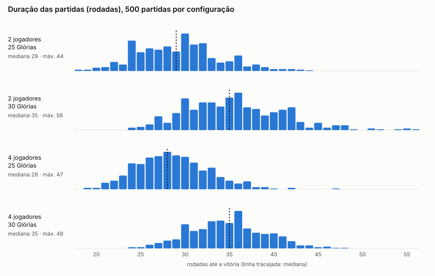
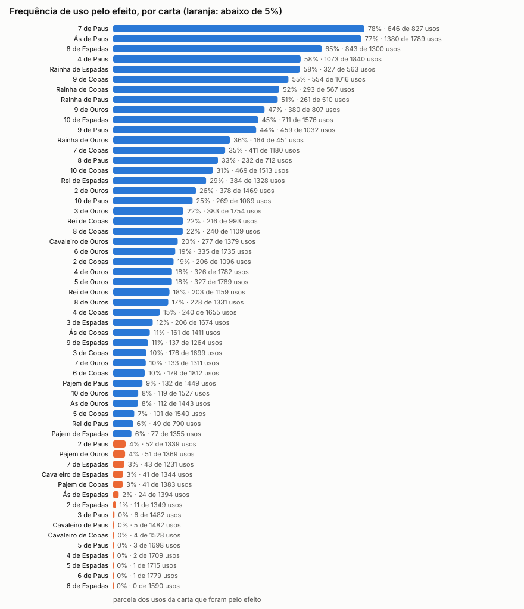
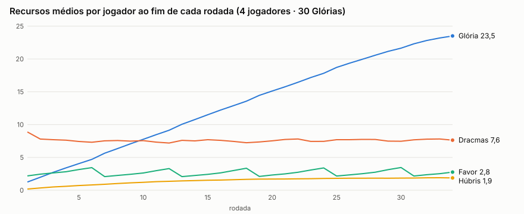
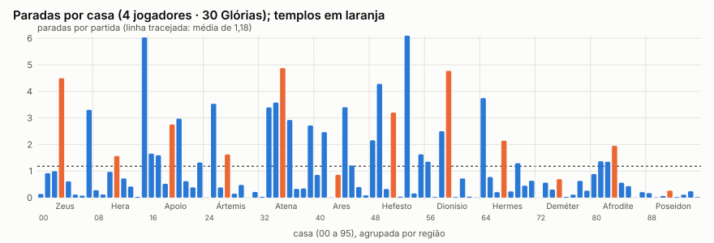
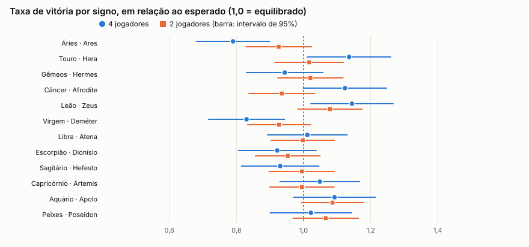

# ASTRAL — Auditoria de balanceamento v2

Medições da branch `claude/ecstatic-planck-s4ja14` com os valores atuais do jogo, sem alterar custos,
efeitos, movimentos ou condições de vitória. Todas as partidas são IA contra IA, com signos sorteados.
Gerado por `npm run audit` (dados brutos em `docs/auditoria/`).

## Resumo

- **Duração**: com a meta de 30 Glórias, as partidas duram 35 rodadas na mediana (até 56); com 25, duram 28 a 29.
- **A Glória vem das casas, não das cartas**: parar numa casa de Glória é o melhor turno do jogo e responde por cerca de 54% de toda a Glória ganha. Templos (com as cartas jogadas na chegada) dão 29% e cartas jogadas pelo efeito, 13%.
- **Só 20% das cartas são jogadas pelo efeito**, e isso é efeito do balanceamento: políticas de IA que forçam mais efeitos perdem para a atual.
- **15 das 56 cartas praticamente nunca são jogadas pelo efeito**, quase todas de interação ou de informação.
- **O dinheiro não acumula**: os jogadores ficam em torno de 7,5 Dracmas a partida inteira, abaixo do preço de qualquer relíquia e das cartas mais fortes.
- **A concentração de movimento em 3 passos não prejudica o acesso às casas**: os resultados são iguais aos da distribuição anterior.
- **Com 4 jogadores há desequilíbrio entre signos** (de 19,7% a 28,6% de vitórias), ligado à casa inicial; com 2 jogadores não há diferença detectável.

## As cinco mudanças com maior potencial

Nenhuma foi aplicada: os valores do jogo estão como antes da auditoria.

### 1. Reduzir o peso das casas de Glória

- **Evidência**: 18,7% de todos os turnos terminam numa casa de Glória, com +2,01 de Glória e nenhum custo. É o turno de maior valor (8,2 Dracmas equivalentes, contra 1,9 de jogar uma carta pelo efeito e 0,1 de parar num templo). Cada casa de Glória recebe 4,3 paradas por partida, 3,6 vezes a média; as casas 53 e 15 passam de 6. Multiplicando frequência e ganho de cada tipo de turno, essas seis casas geram cerca de 54% da Glória.
- **Proposta**: voltar a parada para +1 Glória (o valor do documento v1.6) ou limitar cada jogador a uma parada em casa de Glória a cada 3 rodadas, como já ocorre com a Ascensão de Zeus.
- **Efeito esperado**: templos e cartas passam a ser a fonte principal de Glória, como o rebalanceamento pretendia. A partida fica mais longa, então convém combinar com a meta de 25 Glórias.

### 2. Rever as 15 cartas que ninguém joga pelo efeito

- **Evidência**: 3, 5 e 6 de Paus, os Cavaleiros de Paus e de Copas e o 4, 5 e 6 de Espadas têm menos de 0,5% de uso pelo efeito; 2 de Paus, Pajem de Copas, Ás, 2 e 7 de Espadas, Cavaleiro de Espadas e Pajem de Ouros ficam abaixo de 4%. Há só 0,51 sabotagem por partida, e 0,46 delas vêm de uma única carta (8 de Paus). As sabotagens de roubo, política, deslocamento e interferência somam 0,05 por partida.
- **Proposta**: baratear as cartas de ataque e tirar delas a Húbris de quem joga (roubar 3 Dracmas custa 3 Dracmas, uma Húbris e o turno); dar um ganho próprio pequeno às cartas de informação.
- **Ressalva**: a IA não dá valor a ver cartas do Destino nem a trocar a mão, então parte do desuso das cartas de Espadas é da IA. Para as cartas de ataque, o retorno medido é baixo de fato (de −1,5 a 2,0 Dracmas equivalentes).

### 3. Tornar atraentes as ações de templo que nunca são escolhidas

- **Evidência**: em Atena, 42% das visitas terminam em "nenhuma ação" e nenhuma das três ações próprias é usada. A ação principal nunca é escolhida em Apolo, Atena, Ares, Hefesto e Afrodite. Os investimentos somam 0,09 por partida: a Forja não é usada e a Colheita é rara. As três ações políticas (Campanha, Intriga, Decreto de Proteção) e o Confronto de Ares têm zero usos.
- **Proposta**: a Forja devolve 16 Dracmas em 8 rodadas por 10 (ganho de 6 ao longo de um quarto da partida); reduzir o custo ou encurtar o prazo. Baratear as ações de Atena e de Apolo ou dar a elas um efeito imediato. Rever o Confronto (4 Dracmas e 1 Favor para disputar 1 Glória no dado de Favor).
- **Efeito esperado**: hoje 35% a 69% das visitas a um templo servem só para jogar uma carta; as ações próprias passariam a dar motivo para visitar templos específicos.

### 4. Alinhar os preços ao dinheiro que de fato circula

- **Evidência**: a média de Dracmas por jogador fica entre 7,4 e 8,9 ao fim de cada rodada. O Rei de Paus (18) é jogado pelo efeito em 6% dos usos e o 10 de Paus (14) em 25%, embora sejam as cartas de maior Glória. Compram-se 0,58 relíquia por jogador por partida. No Tártaro, as 0,82 saídas por partida são todas por Penitência: ninguém paga o Suborno de 8 nem aceita o Pacto.
- **Proposta**: baixar o topo da tabela (relíquias de 8 a 14, Reis de 3 a 4 Dracmas a menos, Suborno de 5 ou 6), ou aumentar a renda que não seja Glória. Baixar preços é o caminho mais simples, porque mais renda também facilita as cartas de Glória.

### 5. Corrigir a vantagem da casa inicial

- **Evidência**: com 4 jogadores, Leão (28,6%), Touro (28,4%) e Câncer (28,1%) vencem bem mais que Áries (19,7%) e Virgem (20,8%); o teste qui-quadrado dá 30,4, acima do limite de 19,7. Os signos fracos começam nos templos de Ares e Deméter, que estão entre os menos visitados do mapa (0,86 e 0,69 visitas por partida, contra 4,5 a 4,9 de Zeus, Atena e Dionísio). Leão começa no templo de Zeus, a 4 casas de uma casa de Glória. Há também uma leve vantagem para quem joga primeiro (26,7% contra 23,3% do último).
- **Proposta**: começar todos numa mesma casa, ou sortear a casa inicial entre casas equivalentes, mantendo o signo só para o elemento. Uma compensação pequena para os últimos da ordem (1 ou 2 Dracmas) trataria a ordem do turno.
- **Efeito esperado**: a mudança 1 também ajuda, porque parte da vantagem vem da distância até as casas de Glória.

## Respostas às perguntas da auditoria

- **Estratégia dominante**: sim, circular entre as casas de Glória usando as cartas só para mover. Não encontrei geração excessiva de Dracmas: o saldo médio não cresce ao longo da partida.
- **Movimento**: a concentração em 3 passos não muda duração, desigualdade de paradas, visitas a templos nem uso de efeitos em relação à distribuição anterior. As 49 casas pouco visitadas são as que a IA evita de propósito (Pedágio, Nêmesis, Altar, Comum), não casas inacessíveis. Os atalhos e retornos são usados em 26% a 86% das passagens.
- **IA ou balanceamento**: balanceamento. Com o prêmio explícito por efeito, o uso sobe de 20% para 25% e 32%, mas essas IAs vencem só 35,8% e 24,5% dos confrontos de 4 jogadores (39,2% e 28,7% com 2), quando 50% seria empate.
- **Templos pouco atraentes**: Poseidon (0,26 visita por partida), Deméter (0,69) e Ares (0,86). Os mais eficientes em Glória por visita são Ares (1,85), Zeus (1,55) e Hefesto (1,53), todos pelas cartas de Paus jogadas ali.
- **Meta de vitória**: 25 Glórias encurta a partida em 6 rodadas sem mudar o formato da distribuição.

## 1. Duração das partidas

| Configuração | Partidas | Média | Mediana | P10 | P90 | Máxima | Inacabadas |
|---|---|---|---|---|---|---|---|
| 2 jogadores · 25 Glórias | 500 | 29,4 | 29 | 24 | 36 | 44 | 0 |
| 2 jogadores · 30 Glórias | 500 | 35,6 | 35 | 29 | 42 | 56 | 0 |
| 4 jogadores · 25 Glórias | 500 | 28,7 | 28 | 24 | 34 | 47 | 0 |
| 4 jogadores · 30 Glórias | 500 | 34,8 | 35 | 30 | 40 | 48 | 0 |

Duração em rodadas completas (cada jogador joga uma vez por rodada).

## 2. Auditoria das 56 cartas

Configuração: 4 jogadores · 30 Glórias, 500 partidas. "Compras" conta cada vez que a carta entrou numa mão. O benefício médio é a variação dos recursos de quem jogou, do momento do efeito até o fim do turno, com o custo devolvido (bruto). "Valor" converte o benefício em Dracmas equivalentes (Glória 4, Favor 1,5, Húbris −1,5) para comparar com o custo.

| Carta | Uso | Custo | Compras | Movimento | Efeito | Armadilha | % efeito | Custo pago | ΔGlória | ΔDracmas | ΔFavor | ΔHúbris | Valor | % efeito por IA (1–4) |
|---|---|---|---|---|---|---|---|---|---|---|---|---|---|---|
| Ás de Paus | Universal | 4 | 2001 | 404 | 1380 | 5 | 77% | 3,7 | 1,00 | 0,2 | -0,00 | -0,04 | 4,2 | 77% · 77% · 79% · 75% |
| 2 de Paus | Universal | 2 | 1717 | 1085 | 52 | 202 | 4% | 1,5 | 0,06 | 5,1 | 0,00 | 1,02 | 3,8 | 3% · 4% · 5% · 3% |
| 3 de Paus | Universal | 3 | 1781 | 1330 | 6 | 146 | 0% | 2,2 | 0,00 | 3,0 | 0,00 | 1,00 | 1,5 | 1% · 0% · 1% · 0% |
| 4 de Paus | Universal | 8 | 2006 | 767 | 1073 | 0 | 58% | 7,7 | 2,00 | 0,2 | 0,00 | 0,96 | 6,7 | 52% · 61% · 61% · 59% |
| 5 de Paus | Universal | 4 | 1924 | 1661 | 3 | 34 | 0% | 4,0 | 0,00 | 0,0 | 0,00 | 1,00 | -1,5 | 0% · 0% · 0% · 0% |
| 6 de Paus | Universal | 3 | 1991 | 1708 | 1 | 70 | 0% | 2,0 | 0,00 | 7,0 | 0,00 | 2,00 | 4,0 | 0% · 0% · 0% · 0% |
| 7 de Paus | Elemental | 10 | 1353 | 181 | 646 | 0 | 78% | 9,7 | 3,00 | 0,1 | -0,05 | 2,00 | 9,0 | 76% · 86% · 75% · 76% |
| 8 de Paus | Elemental | 9 | 1243 | 474 | 232 | 6 | 33% | 8,6 | 1,00 | 0,1 | -0,03 | 1,00 | 2,5 | 30% · 28% · 37% · 36% |
| 9 de Paus | Elemental | 8 | 1438 | 562 | 459 | 11 | 44% | 7,7 | 2,17 | 0,1 | -0,04 | 0,15 | 8,5 | 46% · 48% · 42% · 42% |
| 10 de Paus | Elemental | 14 | 1496 | 820 | 269 | 0 | 25% | 13,7 | 4,00 | 0,0 | -0,02 | 2,99 | 11,5 | 23% · 23% · 27% · 26% |
| Pajem de Paus | Elemental | 3 | 1828 | 1075 | 132 | 242 | 9% | 2,6 | 0,00 | 1,8 | -0,06 | -1,17 | 3,5 | 11% · 7% · 9% · 9% |
| Cavaleiro de Paus | Divina: Ares | 6 | 1762 | 1463 | 5 | 14 | 0% | 5,4 | 0,00 | 5,0 | 0,00 | 2,00 | 2,0 | 0% · 0% · 1% · 0% |
| Rainha de Paus | Divina: Hefesto | 10 | 1128 | 249 | 261 | 0 | 51% | 9,6 | 2,00 | 0,0 | -0,03 | 0,00 | 8,0 | 55% · 53% · 52% · 44% |
| Rei de Paus | Divina: Zeus | 18 | 1259 | 741 | 49 | 0 | 6% | 17,6 | 5,00 | 0,2 | -0,14 | 3,00 | 15,5 | 5% · 7% · 8% · 4% |
| Ás de Copas | Universal | 2 | 1794 | 978 | 161 | 272 | 11% | 1,6 | 0,00 | 0,1 | 2,00 | -0,03 | 3,2 | 11% · 10% · 12% · 12% |
| 2 de Copas | Universal | 3 | 1543 | 740 | 206 | 150 | 19% | 2,7 | 0,00 | 0,0 | -0,01 | -1,90 | 2,9 | 20% · 20% · 18% · 18% |
| 3 de Copas | Universal | 2 | 1940 | 1390 | 176 | 133 | 10% | 1,6 | 0,00 | 5,1 | 0,00 | -0,02 | 5,1 | 12% · 11% · 10% · 9% |
| 4 de Copas | Universal | 4 | 1878 | 1378 | 240 | 37 | 15% | 3,6 | 0,00 | 0,1 | 3,00 | -0,02 | 4,6 | 15% · 15% · 14% · 14% |
| 5 de Copas | Universal | 5 | 1791 | 1430 | 101 | 9 | 7% | 4,7 | 0,00 | 0,0 | 0,00 | -2,89 | 4,3 | 6% · 6% · 7% · 7% |
| 6 de Copas | Universal | 3 | 2008 | 1564 | 179 | 69 | 10% | 2,6 | 0,00 | 2,2 | 2,00 | -0,04 | 5,2 | 9% · 11% · 10% · 10% |
| 7 de Copas | Elemental | 6 | 1539 | 739 | 411 | 30 | 35% | 5,7 | 0,00 | 0,2 | 3,81 | -0,01 | 6,0 | 34% · 34% · 38% · 32% |
| 8 de Copas | Elemental | 6 | 1504 | 830 | 240 | 39 | 22% | 5,7 | 0,00 | 0,1 | 0,90 | -2,41 | 5,1 | 22% · 21% · 24% · 20% |
| 9 de Copas | Elemental | 8 | 1462 | 454 | 554 | 8 | 55% | 7,7 | 1,00 | 0,2 | 1,89 | -0,01 | 7,0 | 53% · 52% · 56% · 57% |
| 10 de Copas | Elemental | 9 | 1829 | 1044 | 469 | 0 | 31% | 8,7 | 2,00 | 0,2 | -0,09 | -1,03 | 9,6 | 30% · 31% · 34% · 29% |
| Pajem de Copas | Elemental | 3 | 1730 | 1106 | 41 | 236 | 3% | 2,7 | 0,00 | 0,0 | 0,00 | 0,00 | 0,0 | 3% · 3% · 3% · 3% |
| Cavaleiro de Copas | Divina: Poseidon | 6 | 1784 | 1512 | 4 | 12 | 0% | 5,5 | 0,00 | 0,0 | 0,00 | 0,00 | 0,0 | 0% · 0% · 1% · 0% |
| Rainha de Copas | Divina: Afrodite | 10 | 1131 | 274 | 293 | 0 | 52% | 9,7 | 2,00 | 0,0 | 1,97 | 0,00 | 11,0 | 50% · 57% · 48% · 51% |
| Rei de Copas | Divina: Dionísio | 15 | 1542 | 777 | 216 | 0 | 22% | 14,6 | 4,00 | 0,4 | -0,13 | 0,95 | 14,8 | 24% · 24% · 20% · 19% |
| Ás de Espadas | Universal | 2 | 1782 | 1069 | 24 | 301 | 2% | 1,6 | 0,00 | 0,0 | 0,00 | 0,00 | 0,0 | 2% · 2% · 2% · 1% |
| 2 de Espadas | Universal | 2 | 1730 | 1096 | 11 | 242 | 1% | 1,3 | 0,00 | 0,0 | 0,00 | 0,00 | 0,0 | 1% · 0% · 1% · 2% |
| 3 de Espadas | Universal | 2 | 1926 | 1326 | 206 | 142 | 12% | 1,5 | 0,00 | 0,1 | 2,00 | -0,03 | 3,2 | 11% · 11% · 14% · 13% |
| 4 de Espadas | Universal | 3 | 1940 | 1626 | 2 | 81 | 0% | 2,0 | 0,00 | 0,0 | 0,00 | 0,00 | 0,0 | 0% · 0% · 0% · 0% |
| 5 de Espadas | Universal | 4 | 1920 | 1690 | 1 | 24 | 0% | 3,0 | 0,00 | 0,0 | 0,00 | 0,00 | 0,0 | 0% · 0% · 0% · 0% |
| 6 de Espadas | Universal | 4 | 1827 | 1568 | 0 | 22 | 0% | — | — | — | — | — | — | 0% · 0% · 0% · 0% |
| 7 de Espadas | Elemental | 5 | 1604 | 1096 | 43 | 92 | 3% | 4,5 | 0,00 | 0,0 | 0,00 | 0,00 | 0,0 | 4% · 2% · 4% · 4% |
| 8 de Espadas | Elemental | 7 | 1638 | 447 | 843 | 10 | 65% | 6,5 | 1,79 | 0,1 | -0,04 | -0,01 | 7,3 | 62% · 68% · 64% · 66% |
| 9 de Espadas | Elemental | 5 | 1631 | 1033 | 137 | 94 | 11% | 4,5 | 0,00 | 0,1 | 0,93 | 0,00 | 1,5 | 12% · 12% · 10% · 9% |
| 10 de Espadas | Elemental | 9 | 1817 | 864 | 711 | 1 | 45% | 8,6 | 2,00 | 0,1 | 1,94 | -0,01 | 11,0 | 42% · 46% · 45% · 47% |
| Pajem de Espadas | Elemental | 3 | 1778 | 1039 | 77 | 239 | 6% | 2,5 | 0,00 | 0,1 | -0,08 | 0,00 | -0,1 | 8% · 7% · 4% · 4% |
| Cavaleiro de Espadas | Divina: Hermes | 7 | 1673 | 1292 | 41 | 11 | 3% | 6,4 | 0,00 | 0,0 | -0,02 | 0,00 | -0,0 | 3% · 3% · 3% · 4% |
| Rainha de Espadas | Divina: Atena | 10 | 1170 | 236 | 327 | 0 | 58% | 9,6 | 2,00 | 0,0 | -0,05 | -0,01 | 8,0 | 55% · 64% · 60% · 53% |
| Rei de Espadas | Divina: Apolo | 11 | 1653 | 944 | 384 | 0 | 29% | 10,5 | 3,00 | 0,1 | -0,06 | 0,00 | 12,0 | 29% · 27% · 30% · 30% |
| Ás de Ouros | Universal | 2 | 1796 | 1042 | 112 | 289 | 8% | 1,7 | 0,00 | 5,3 | 0,00 | -0,06 | 5,3 | 8% · 6% · 10% · 7% |
| 2 de Ouros | Universal | 2 | 1794 | 918 | 378 | 173 | 26% | 1,7 | 0,00 | 6,1 | -0,01 | -0,02 | 6,1 | 24% · 26% · 28% · 26% |
| 3 de Ouros | Universal | 2 | 1976 | 1240 | 383 | 131 | 22% | 1,7 | 0,00 | 4,1 | 1,00 | -0,02 | 5,6 | 22% · 22% · 19% · 25% |
| 4 de Ouros | Universal | 3 | 1994 | 1373 | 326 | 83 | 18% | 2,7 | 0,00 | 8,1 | 0,00 | -0,04 | 8,2 | 16% · 20% · 19% · 19% |
| 5 de Ouros | Universal | 4 | 1967 | 1429 | 327 | 33 | 18% | 3,6 | 0,00 | 7,1 | 0,00 | -0,87 | 8,4 | 17% · 17% · 22% · 18% |
| 6 de Ouros | Universal | 4 | 1937 | 1366 | 335 | 34 | 19% | 3,7 | 0,00 | 9,1 | 0,00 | -0,03 | 9,2 | 21% · 18% · 17% · 21% |
| 7 de Ouros | Elemental | 5 | 1680 | 1092 | 133 | 86 | 10% | 4,6 | 0,00 | 10,0 | -0,03 | 0,00 | 10,0 | 12% · 10% · 9% · 10% |
| 8 de Ouros | Elemental | 5 | 1690 | 1019 | 228 | 84 | 17% | 4,7 | 0,00 | 8,1 | 0,96 | -0,00 | 9,5 | 15% · 20% · 18% · 16% |
| 9 de Ouros | Elemental | 9 | 1314 | 426 | 380 | 1 | 47% | 8,7 | 2,00 | 6,1 | -0,03 | -0,00 | 14,0 | 44% · 44% · 46% · 54% |
| 10 de Ouros | Elemental | 6 | 1792 | 1394 | 119 | 14 | 8% | 5,6 | 0,00 | 12,0 | -0,01 | 0,00 | 12,0 | 8% · 9% · 7% · 7% |
| Pajem de Ouros | Elemental | 3 | 1725 | 1086 | 51 | 232 | 4% | 2,6 | 0,00 | 5,1 | -0,04 | 0,00 | 5,0 | 2% · 5% · 4% · 3% |
| Cavaleiro de Ouros | Divina: Ártemis | 8 | 1690 | 1099 | 277 | 3 | 20% | 7,7 | 2,00 | 0,0 | -0,01 | -0,00 | 8,0 | 21% · 21% · 22% · 17% |
| Rainha de Ouros | Divina: Deméter | 10 | 1079 | 287 | 164 | 0 | 36% | 9,6 | 2,00 | 8,0 | 0,00 | 0,00 | 16,0 | 46% · 34% · 33% · 33% |
| Rei de Ouros | Divina: Hera | 12 | 1547 | 956 | 203 | 0 | 18% | 11,7 | 3,00 | 0,1 | 1,93 | -0,51 | 15,8 | 20% · 18% · 18% · 15% |

**Cartas quase nunca usadas pelo efeito (menos de 5% dos usos):** 2 de Paus (3,9%), 3 de Paus (0,4%), 5 de Paus (0,2%), 6 de Paus (0,1%), Cavaleiro de Paus (0,3%), Pajem de Copas (3,0%), Cavaleiro de Copas (0,3%), Ás de Espadas (1,7%), 2 de Espadas (0,8%), 4 de Espadas (0,1%), 5 de Espadas (0,1%), 6 de Espadas (0,0%), 7 de Espadas (3,5%), Cavaleiro de Espadas (3,1%), Pajem de Ouros (3,7%).

**Cartas mais jogadas pelo efeito:** Ás de Paus (9,8% de todos os efeitos), 4 de Paus (7,6% de todos os efeitos), 8 de Espadas (6,0% de todos os efeitos), 10 de Espadas (5,0% de todos os efeitos), 7 de Paus (4,6% de todos os efeitos), 9 de Copas (3,9% de todos os efeitos), 10 de Copas (3,3% de todos os efeitos), 9 de Paus (3,3% de todos os efeitos).

**Melhor relação valor/custo:** Rainha de Ouros (valor 16,0 por custo 9,6), 10 de Ouros (valor 12,0 por custo 5,6), 4 de Ouros (valor 8,2 por custo 2,7), 6 de Ouros (valor 9,2 por custo 3,7), 7 de Ouros (valor 10,0 por custo 4,6), 9 de Ouros (valor 14,0 por custo 8,7).

Por naipe: Paus 26% · Copas 18% · Espadas 14% · Ouros 18%. Por tipo: universais 15% · elementais 25% · divinas 18%.

## 3. Auditoria dos 12 templos

Configuração: 4 jogadores · 30 Glórias. "Visitas" são paradas no templo por movimento; "sem opção" são visitas em que nada era pagável. Dracmas gastos e Glória obtida somam a variação do jogador da escolha até o fim do turno.

| Templo | Visitas/partida | Sem opção | Principal | Secundária | Política | Carta | Relíquia | Nada | Dracmas gastos/visita | Glória/visita | Relíquias/partida | Investimentos/partida |
|---|---|---|---|---|---|---|---|---|---|---|---|---|
| Zeus | 4,50 | 8% | 28% | 16% | 0% | 35% | 3% | 9% | 7,0 | 1,55 | 0,13 | — |
| Hera | 1,57 | 13% | 39% | 0% | 0% | 38% | 2% | 7% | 1,7 | 0,42 | 0,04 | — |
| Apolo | 2,75 | 17% | 0% | 4% | 0% | 47% | 14% | 18% | 6,3 | 0,90 | 0,39 | — |
| Ártemis | 1,62 | 0% | 39% | 0% | 0% | 46% | 15% | 0% | 2,9 | 0,55 | 0,24 | — |
| Atena | 4,88 | 7% | 0% | 0% | 0% | 43% | 7% | 42% | 4,8 | 0,84 | 0,36 | — |
| Ares | 0,86 | 19% | 0% | 0% | 0% | 69% | 1% | 12% | 7,9 | 1,85 | 0,01 | — |
| Hefesto | 3,20 | 16% | 0% | 0% | 0% | 66% | 2% | 16% | 7,5 | 1,53 | 0,06 | 0,00 |
| Dionísio | 4,78 | 0% | 34% | 5% | 0% | 48% | 13% | 0% | 5,1 | 0,59 | 0,74 | — |
| Hermes | 2,14 | 0% | 32% | 0% | 0% | 58% | 8% | 1% | 4,8 | 0,45 | 0,18 | — |
| Deméter | 0,69 | 11% | 12% | 0% | 0% | 69% | 4% | 4% | 2,5 | 0,81 | 0,04 | 0,09 |
| Afrodite | 1,95 | 9% | 0% | 21% | 0% | 56% | 5% | 9% | 5,6 | 0,68 | 0,10 | — |
| Poseidon | 0,26 | 0% | 48% | 0% | 0% | 36% | 15% | 0% | 4,6 | 0,40 | 0,04 | — |

Ações escolhidas, em vezes por partida:

| Templo | Ações (vezes por partida) |
|---|---|
| Zeus | Jogar carta 1,58 · Ascensão 1,28 · Decreto Olímpico 0,74 · Nenhuma ação 0,40 · Comprar Raio de Zeus 0,13 |
| Hera | Influência 0,61 · Jogar carta 0,60 · Nenhuma ação 0,11 · Comprar Coroa de Hera 0,04 |
| Apolo | Jogar carta 1,30 · Nenhuma ação 0,50 · Comprar Lira de Apolo 0,39 · Purificação 0,10 |
| Ártemis | Jogar carta 0,75 · Caçada 0,64 · Comprar Arco de Ártemis 0,24 |
| Atena | Jogar carta 2,12 · Nenhuma ação 2,05 · Comprar Égide de Atena 0,35 |
| Ares | Jogar carta 0,59 · Nenhuma ação 0,10 · Comprar Lança de Ares 0,01 |
| Hefesto | Jogar carta 2,13 · Nenhuma ação 0,50 · Comprar Martelo de Hefesto 0,06 |
| Dionísio | Jogar carta 2,31 · Êxtase 1,60 · Comprar Taça de Dionísio 0,63 · Cassino Divino 0,23 · Nenhuma ação 0,01 |
| Hermes | Jogar carta 1,23 · Comércio 0,69 · Comprar Sandálias de Hermes 0,18 · Nenhuma ação 0,03 |
| Deméter | Jogar carta 0,48 · Colheita 0,09 · Nenhuma ação 0,03 · Comprar Foice de Deméter 0,03 |
| Afrodite | Jogar carta 1,10 · Encantamento 0,40 · Nenhuma ação 0,17 · Comprar Cinto de Afrodite 0,10 |
| Poseidon | Tesouro Submerso 0,13 · Jogar carta 0,10 · Comprar Tridente de Poseidon 0,04 |

## 4. Economia e interação

| Rodada | Glória | Dracmas | Favor | Húbris | Jogadores com Húbris ≥ 4 |
|---|---|---|---|---|---|
| 1 | 1,2 | 8,9 | 2,2 | 0,18 | 0,0% |
| 5 | 4,1 | 7,4 | 3,2 | 0,71 | 1,7% |
| 10 | 7,8 | 7,6 | 2,6 | 1,21 | 7,0% |
| 15 | 11,5 | 7,7 | 2,4 | 1,52 | 10,8% |
| 20 | 15,1 | 7,5 | 2,3 | 1,71 | 13,8% |
| 25 | 18,7 | 7,7 | 2,2 | 1,81 | 16,3% |
| 30 | 21,7 | 7,5 | 3,5 | 1,85 | 17,6% |

Húbris elevada: 10,9% das posições de fim de rodada têm Húbris ≥ 4 e 0,01% têm ≥ 6.

**Interação, por partida:**

| Evento | Por partida | Por jogador |
|---|---|---|
| Prisões | 0,86 | 0,22 |
| Duelos | 3,33 | 0,83 |
| Duelos: atacante vence | 1,48 | 0,37 |
| Duelos: defensor vence | 0,92 | 0,23 |
| Duelos: empate | 0,92 | 0,23 |
| Duelos por Glória (Ares) | 0,00 | 0,00 |
| Sabotagens | 0,51 | 0,13 |
| Sabotagens anuladas por Decreto | 0,00 | 0,00 |
| Armadilhas armadas | 8,29 | 2,07 |
| Armadilhas disparadas | 6,86 | 1,72 |
| Relíquias compradas | 2,33 | 0,58 |
| Investimentos | 0,09 | 0,02 |
| Eleições | 5,22 | 1,31 |
| Eleições: cargo vago | 0,04 | 0,01 |
| Arcanos Maiores revelados | 6,37 | 1,59 |

Sabotagens por tipo: ataque 0,46 · roubo 0,02 · deslocamento 0,01 · politica 0,01 · interferencia 0,01. Saídas do Tártaro: Penitência 0,82.

**Retorno médio por tipo de turno** (variação dos recursos de quem jogou, do início ao fim do turno):

| Turno | % dos turnos | ΔGlória | ΔDracmas | ΔFavor | ΔHúbris | Valor em Dracmas equivalentes |
|---|---|---|---|---|---|---|
| Mover → Templo | 21,2% | 0,94 | -3,42 | 0,11 | 0,29 | 0,1 |
| Mover → Glória | 18,7% | 2,01 | 0,26 | -0,08 | -0,00 | 8,2 |
| Mover → Dracmas | 11,7% | 0,00 | 5,88 | -0,04 | 0,08 | 5,7 |
| Efeito de carta | 10,1% | 0,88 | -2,37 | 0,49 | -0,03 | 1,9 |
| Mover → Favor | 8,9% | 0,00 | 0,77 | 1,97 | 0,03 | 3,7 |
| Armar armadilha | 6,0% | 0,00 | -2,83 | 0,00 | -0,04 | -2,8 |
| Mover → Evento | 5,6% | 0,17 | 0,18 | 0,15 | 0,08 | 1,0 |
| Mover → Destino | 4,6% | 0,32 | -0,11 | 0,13 | 0,12 | 1,2 |
| Mover → Tesouro | 3,4% | 0,00 | 6,16 | -0,06 | 0,08 | 5,9 |
| Mover → Comum | 3,1% | 0,00 | 1,82 | -0,00 | 0,00 | 1,8 |
| Mover → Provação | 2,4% | 0,16 | 1,55 | -0,02 | 0,29 | 1,7 |
| Mover → Bifurcação | 1,0% | 0,01 | 0,16 | -0,00 | 0,06 | 0,1 |
| Encerrar sem agir | 0,7% | 0,00 | 0,00 | 0,00 | 0,00 | 0,0 |
| Mover → Altar | 0,7% | 0,00 | -1,08 | 0,94 | -0,01 | 0,3 |
| Tártaro | 0,6% | 0,00 | 0,00 | 0,00 | -2,00 | 3,0 |
| Mover → Pedágio divino | 0,5% | 0,00 | -2,26 | 0,00 | 0,24 | -2,6 |
| Mover → Nêmesis | 0,3% | 0,00 | -0,05 | 0,00 | -0,01 | -0,0 |
| Mover → Delfos | 0,2% | 0,00 | -1,94 | 0,00 | 0,06 | -2,0 |
| Comprar relíquia (parado) | 0,1% | 0,00 | -10,03 | 0,00 | -0,02 | -10,0 |
| Mover → Tártaro | 0,0% | 0,00 | -1,72 | 0,00 | 0,00 | -1,7 |

Os jogadores terminam a partida com 7,2 Dracmas em média.

## 5. Movimento

Distribuição atual de movimento nas 56 cartas: 4 cartas de 1 · 8 cartas de 2 · 20 cartas de 3 · 12 cartas de 4 · 8 cartas de 5 · 4 cartas de 6.

| Tipo de casa | Casas | Paradas por casa por partida | Em relação à média |
|---|---|---|---|
| Comum | 12 | 0,36 | 0,30 |
| Dracmas | 10 | 1,62 | 1,37 |
| Pedágio divino | 8 | 0,09 | 0,07 |
| Favor | 8 | 1,54 | 1,30 |
| Glória | 6 | 4,29 | 3,63 |
| Provação | 6 | 0,55 | 0,46 |
| Destino | 6 | 1,06 | 0,90 |
| Nêmesis | 4 | 0,12 | 0,10 |
| Bifurcação | 6 | 0,24 | 0,20 |
| Templo | 12 | 2,43 | 2,06 |
| Evento | 6 | 1,29 | 1,09 |
| Altar | 6 | 0,15 | 0,13 |
| Tesouro | 4 | 1,18 | 1,00 |
| Delfos | 1 | 0,24 | 0,20 |
| Tártaro | 1 | 0,04 | 0,03 |

**Casas mais visitadas** (acima de 1,6× a média): 53 Glória (6,10), 15 Glória (6,03), 35 Templo de Atena (4,88), 59 Templo de Dionísio (4,78), 03 Templo de Zeus (4,50), 49 Dracmas (4,28), 64 Tesouro (3,75), 34 Favor (3,58), 25 Glória (3,53), 44 Glória (3,40), 33 Glória (3,40), 07 Glória (3,30), 51 Templo de Hefesto (3,20), 20 Dracmas (2,97), 36 Evento (2,92), 19 Templo de Apolo (2,75), 39 Dracmas (2,72), 58 Dracmas (2,50), 41 Favor (2,47), 48 Destino (2,16), 67 Templo de Hermes (2,14), 83 Templo de Afrodite (1,95).

**Casas menos visitadas** (abaixo de metade da média): 00 Comum (0,14), 05 Comum (0,12), 06 Bifurcação (0,08), 08 Evento (0,28), 09 Comum (0,12), 13 Comum (0,42), 14 Nêmesis (0,03), 18 Comum (0,52), 22 Bifurcação (0,39), 24 Comum (0,00), 26 Evento (0,38), 28 Comum (0,15), 29 Destino (0,48), 30 Nêmesis (0,00), 31 Dracmas (0,21), 32 Comum (0,03), 37 Comum (0,33), 38 Bifurcação (0,34), 42 Pedágio divino (0,01), 46 Nêmesis (0,40), 47 Pedágio divino (0,09), 50 Pedágio divino (0,33), 52 Tártaro (0,04), 54 Bifurcação (0,16), 57 Pedágio divino (0,02), 60 Pedágio divino (0,02), 62 Nêmesis (0,04), 63 Pedágio divino (0,01), 66 Pedágio divino (0,21), 68 Delfos (0,24), 70 Bifurcação (0,45), 72 Pedágio divino (0,00), 73 Tesouro (0,56), 74 Favor (0,30), 76 Altar (0,03), 77 Provação (0,11), 79 Provação (0,26), 84 Dracmas (0,56), 85 Provação (0,43), 86 Bifurcação (0,00), 87 Provação (0,21), 88 Tesouro (0,17), 89 Altar (0,01), 90 Altar (0,06), 91 Templo (0,26), 92 Altar (0,02), 93 Destino (0,11), 94 Tesouro (0,24), 95 Altar (0,02).

**Concentração em 3 passos contra a distribuição anterior** (300 partidas com o movimento antigo, 2 cartas de cada naipe por valor extremo):

| Medida | Movimento atual | Movimento anterior |
|---|---|---|
| Rodadas (média) | 34,8 | 34,8 |
| Desigualdade das paradas entre casas (Gini; 0 = uniforme) | 0,611 | 0,622 |
| Casas com menos de metade da média de paradas | 49 | 51 |
| Visitas a templos por jogador por partida | 7,3 | 7,5 |
| Cartas usadas pelo efeito | 20% | 20% |

**Atalhos e retornos** (vezes em que um movimento saiu da casa com duas saídas):

| Casa | Tipo | Saída normal / alternativa | Passagens por partida | Escolheu a alternativa |
|---|---|---|---|---|
| 06 | Atalho para dentro | 07 / 32 | 5,89 | 44% |
| 22 | Atalho para dentro | 23 / 48 | 7,21 | 42% |
| 38 | Atalho para dentro | 39 / 64 | 10,48 | 29% |
| 54 | Atalho para dentro | 55 / 80 | 7,93 | 49% |
| 70 | Volta ao início | 71 / 00 | 4,14 | 55% |
| 86 | Volta ao início | 87 / 16 | 1,17 | 65% |
| 28 | Retorno para fora | 29 / 02 | 4,05 | 73% |
| 39 | Retorno para fora | 40 / 13 | 7,36 | 46% |
| 60 | Retorno para fora | 61 / 34 | 8,04 | 86% |
| 71 | Retorno para fora | 72 / 45 | 1,84 | 37% |
| 84 | Retorno para fora | 85 / 58 | 5,29 | 77% |
| 92 | Retorno para fora | 93 / 66 | 0,67 | 26% |

## 6. Inteligência artificial

A política atual simula cada comando possível e escolhe o de maior valor. As alternativas somam um prêmio explícito ao valor de jogar uma carta pelo efeito e pesam mais a aproximação aos templos onde as cartas da mão valem: **Efeito+** (prêmio 4, aproximação ×2) e **Efeito++** (prêmio 10, aproximação ×3).

**Todas as IAs com a mesma política** (4 jogadores, 30 Glórias):

| Política | Partidas | Cartas pelo efeito | Rodadas (média) | Visitas a templos por jogador | Prisões por jogador |
|---|---|---|---|---|---|
| Atual | 500 | 20% | 34,8 | 7,3 | 0,22 |
| Efeito+ | 200 | 25% | 35,7 | 9,4 | 0,21 |
| Efeito++ | 200 | 32% | 39,2 | 10,4 | 0,26 |

**Confronto direto** (metade dos assentos com a política alternativa, alternando os assentos a cada partida; 50% = políticas equivalentes):

| Alternativa | Jogadores | Partidas | Vitórias da alternativa | Intervalo de 95% |
|---|---|---|---|---|
| Efeito+ | 4 | 400 | 35,8% | 31,1% a 40,4% |
| Efeito++ | 4 | 400 | 24,5% | 20,3% a 28,7% |
| Efeito+ | 2 | 600 | 39,2% | 35,3% a 43,1% |
| Efeito++ | 2 | 600 | 28,7% | 25,0% a 32,3% |

## 7. Equilíbrio entre personagens

Signos sorteados sem repetição a cada partida, com a meta de 30 Glórias: 2400 partidas com 4 jogadores e 2400 com 2. Como o signo é sorteado independentemente do assento, cada signo ocupa todos os assentos com a mesma frequência; as colunas por assento mostram o efeito da ordem do turno.

**4 jogadores** (esperado: 25%)

| Signo | Elemento | Patrono (casa inicial) | Partidas | Vitórias | IC 95% | 1º | 2º | 3º | 4º |
|---|---|---|---|---|---|---|---|---|---|
| Áries | Fogo | Ares (43) | 795 | 19,7% | 17,0%–22,5% | 22% | 17% | 22% | 18% |
| Touro | Terra | Hera (11) | 796 | 28,4% | 25,3%–31,5% | 28% | 25% | 30% | 30% |
| Gêmeos | Ar | Hermes (67) | 835 | 23,6% | 20,7%–26,5% | 22% | 25% | 19% | 29% |
| Câncer | Água | Afrodite (83) | 787 | 28,1% | 24,9%–31,2% | 28% | 28% | 29% | 27% |
| Leão | Fogo | Zeus (03) | 818 | 28,6% | 25,5%–31,7% | 32% | 27% | 27% | 28% |
| Virgem | Terra | Deméter (75) | 771 | 20,8% | 17,9%–23,6% | 27% | 20% | 22% | 14% |
| Libra | Ar | Atena (35) | 803 | 25,3% | 22,3%–28,3% | 27% | 24% | 28% | 23% |
| Escorpião | Água | Dionísio (59) | 790 | 23,0% | 20,1%–26,0% | 27% | 29% | 22% | 14% |
| Sagitário | Fogo | Hefesto (51) | 804 | 23,3% | 20,3%–26,2% | 23% | 21% | 22% | 28% |
| Capricórnio | Terra | Ártemis (27) | 824 | 26,2% | 23,2%–29,2% | 28% | 27% | 25% | 25% |
| Aquário | Ar | Apolo (19) | 802 | 27,3% | 24,2%–30,4% | 29% | 28% | 30% | 23% |
| Peixes | Água | Poseidon (91) | 775 | 25,5% | 22,5%–28,6% | 26% | 24% | 31% | 21% |

**2 jogadores** (esperado: 50%)

| Signo | Elemento | Patrono (casa inicial) | Partidas | Vitórias | IC 95% | 1º | 2º |
|---|---|---|---|---|---|---|---|
| Áries | Fogo | Ares (43) | 391 | 46,3% | 41,3%–51,2% | 49% | 44% |
| Touro | Terra | Hera (11) | 356 | 50,8% | 45,6%–56,0% | 55% | 47% |
| Gêmeos | Ar | Hermes (67) | 394 | 51,0% | 46,1%–56,0% | 55% | 48% |
| Câncer | Água | Afrodite (83) | 387 | 46,8% | 41,8%–51,7% | 50% | 43% |
| Leão | Fogo | Zeus (03) | 406 | 53,9% | 49,1%–58,8% | 57% | 51% |
| Virgem | Terra | Deméter (75) | 423 | 46,3% | 41,6%–51,1% | 47% | 46% |
| Libra | Ar | Atena (35) | 417 | 49,9% | 45,1%–54,7% | 48% | 52% |
| Escorpião | Água | Dionísio (59) | 403 | 47,6% | 42,8%–52,5% | 46% | 50% |
| Sagitário | Fogo | Hefesto (51) | 392 | 49,7% | 44,8%–54,7% | 53% | 46% |
| Capricórnio | Terra | Ártemis (27) | 408 | 49,8% | 44,9%–54,6% | 50% | 50% |
| Aquário | Ar | Apolo (19) | 429 | 54,3% | 49,6%–59,0% | 56% | 52% |
| Peixes | Água | Poseidon (91) | 394 | 53,3% | 48,4%–58,2% | 56% | 50% |

**Ordem do turno:** com 4 jogadores os assentos vencem 26,7% · 24,7% · 25,4% · 23,3%; com 2 jogadores, 51,6% · 48,4%.

**Por elemento (4 jogadores):** Fogo 23,9% · Água 25,6% · Ar 25,4% · Terra 25,2%.

Teste qui-quadrado da hipótese "todos os signos vencem igual" (11 graus de liberdade; acima de 19,7 rejeita a 5%): 30,4 com 4 jogadores e 7,3 com 2.

## Método e limites

- Todas as partidas são IA contra IA com a política do jogo; jogadores humanos se comportam de outra forma, em especial quanto a risco (Húbris) e a ataques.
- Sementes fixas: os números se reproduzem ao rodar o script de novo.
- O benefício atribuído a uma carta ou a um templo é a variação total dos recursos do jogador até o fim do turno, o que inclui efeitos da casa e de duelos no mesmo turno.
- A conversão em "Dracmas equivalentes" (Glória 4, Favor 1,5, Húbris −1,5) é uma régua de comparação, não uma regra do jogo.
- O módulo de contratos e a sabotagem direta estão desligados, como no jogo.
